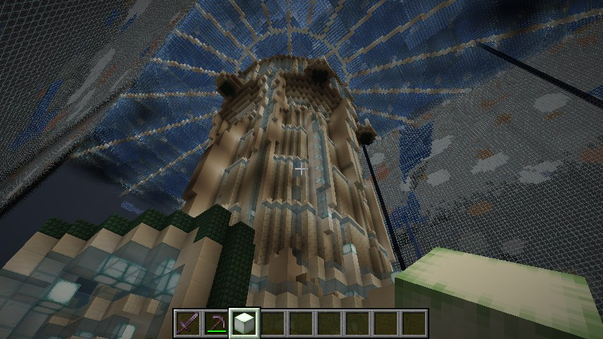
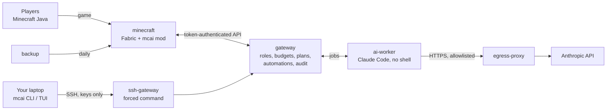

# Minecraft AI Platform

Run your own Minecraft Java server with Claude as an in-game assistant: players ask questions and design builds in
chat, and you stay in control of what the AI may change.



> **Status: pre-release (0.6.2).** Everything listed below works and is tested; see the
> [task board](docs/development/TASKS.md) for what's verified where. Expect changes before 1.0.

## What you get

- **A Minecraft server that's set up properly:** Fabric 1.21.1 in Docker, with a whitelist, daily backups, health
  checks and a setup wizard. Players need no mods: plain Minecraft Java Edition joins.
- **`/ai ask`:** players ask Claude anything ("how do I make a torch?") and the answer appears in their chat.
- **`/ai build`:** players describe a build ("a small lighthouse here"). The AI designs it, the player sees a
  preview, someone with the right role approves it, and it's built. Every build can be undone with `/ai undo`.
- **Roles:** owner, admin, operator, builder, player, auditor. They're tied to each player's account, so who may use
  the AI, build and approve is up to you.
- **Remote administration:** the `mcai` command line and terminal UI work from your laptop over SSH, with keys only
  and no shell. Every change goes to a tamper-evident audit log.
- **Automations:** greet players, show a tour or save the world on a schedule, triggered by events or times.
  There are [11 examples](automation-examples/). The AI can propose automations; a human approves them.
- **[Atlantis](examples/atlantis/README.md):** an original underwater city, 1,200 blocks across, under a glass dome.
  `mcai examples` downloads it, checks it and installs it, and can roll it back.

**Safe by design:** Claude never gets a shell, files, server commands or operator rights. It can only *propose*
actions from a fixed list. The platform checks every proposal against the player's role, the area and a block
budget, and nothing is built without approval. The AI can reach only Anthropic's API, and spending has daily
limits. Details: [security guide](docs/security/README.md).

## What you need

- A computer that stays on while people play: Linux, macOS or Windows, with **6-8 GB of RAM** free, 2 CPU cores and
  10 GB of disk. Linux on x86_64 is the tested setup; see [supported hosts](docs/installation/README.md#supported-hosts).
- [Docker](https://docs.docker.com/get-docker/) with Compose 2.24 or newer.
- **Minecraft Java Edition 1.21.1** for each player.
- For the AI, one of:
  - an [Anthropic API key](https://console.anthropic.com/) (pay per use, recommended);
  - a Claude subscription token.

  Without either, everything except `/ai` works.

## Quick start

```bash
git clone https://github.com/JasonEamesLamarca/minecraft-claude-platform.git
cd minecraft-claude-platform
scripts/setup.sh
```

The wizard checks your computer, asks you to accept the [Minecraft EULA](https://www.minecraft.net/eula), asks a
few questions (your Minecraft name, the AI credential, your SSH key), then builds and starts everything. The first
start downloads Minecraft and takes 5 to 15 minutes. Then:

1. In Minecraft: **Multiplayer → Add Server → `localhost:25565`** (or this computer's LAN address from another one).
2. In game: `/ai ask how do I make a torch?`
3. On your computer: `scripts/doctor.sh` checks everything, and `management-cli/mcai status` shows the server, the AI
   and the backups.

The [installation guide](docs/installation/README.md) explains each step, the memory settings and how to let
friends join.

## How it fits together



Six containers on one host. Only the game port and the SSH port (on 127.0.0.1 by default) are published. The
[architecture overview](docs/architecture/overview.md) and the
[decision records](docs/architecture/adr/README.md) explain the design.

## Documentation

| Guide | For |
| --- | --- |
| [Installation](docs/installation/README.md) | Getting it running, memory sizing, letting friends join |
| [Administration](docs/administration/README.md) | Players and roles, `mcai`, backups and restore, AI settings, automations, Atlantis |
| [Upgrading](docs/upgrade/README.md) | Moving to a new release, and back |
| [Troubleshooting](docs/troubleshooting/README.md) | Symptoms, causes and fixes |
| [Security](docs/security/README.md) | What's protected, what you decide, a checklist before opening up |
| [Architecture](docs/architecture/overview.md) | Services, flows, networks, decisions |
| [Development](docs/development/README.md) | Building, testing, CI and releases |
| [Test results](docs/development/test-results.md) | What was tested, on what, with which versions |

## Repository layout

| Path | Contents |
| --- | --- |
| `containers/` | One folder per service image (minecraft, claude, gateway, management) |
| `minecraft-mod/` | Server-side Fabric mod (`/ai` commands, events to the gateway) |
| `src/mcai/` | Gateway, AI worker, egress proxy, SSH dispatcher (Python, standard library only) |
| `management-cli/` | `mcai` command-line client and terminal UI |
| `automation-examples/` | Example automation definitions |
| `examples/` | `catalog.json` (packs and pinned checksums) and `atlantis/`: the generator, automations, screenshots. Pack files ship as release assets |
| `docs/` | The guides above |
| `scripts/` | Setup wizard, doctor, backup, restore, builds |
| `tests/` | Unit, integration, security and operational tests |

## Contributing, security, license

- [CONTRIBUTING.md](CONTRIBUTING.md) · [CODE_OF_CONDUCT.md](CODE_OF_CONDUCT.md)
- To report a vulnerability, follow [SECURITY.md](SECURITY.md). Please don't open public issues for security problems.
- Licensed under [Apache-2.0](LICENSE). See [NOTICE](NOTICE).

This project is not affiliated with or endorsed by Mojang Studios, Microsoft or Anthropic. "Minecraft" is a trademark
of Mojang Synergies AB. Running a Minecraft server requires accepting the
[Minecraft EULA](https://www.minecraft.net/eula). Using Claude requires your own Anthropic account and is subject
to Anthropic's terms.
