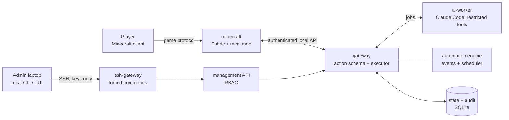

# Minecraft AI Platform

> **Status: pre-alpha, Phase 5.** What works today:
>
> - a hardened Fabric server with backups and a setup wizard;
> - **`/ai ask`** for questions;
> - **`/ai build`**, with a preview, `/ai approve` and `/ai undo`;
> - **roles** per player UUID (builder, operator, admin…);
> - **remote administration** with the `mcai` command line over a locked-down SSH gateway, with a tamper-evident
>   audit log;
> - **automations** on events or schedules, with 11 [examples](automation-examples/).
>
> Read [installation](docs/installation/README.md) and [administration](docs/administration/README.md) to get
> started. Atlantis is still being built.
> [`docs/development/TASKS.md`](docs/development/TASKS.md) tracks what actually works.

## Quick start (what works now)

```bash
git clone https://github.com/JasonEamesLamarca/minecraft-claude-platform.git
cd minecraft-claude-platform
scripts/setup.sh        # checks prerequisites, asks you to accept the Minecraft EULA, generates secrets, starts the server
scripts/doctor.sh       # health and diagnostics
management-cli/mcai status   # after `mcai remote add ...` printed by setup.sh
```

A self-hosted, Docker Compose–based platform that connects a Minecraft Java Edition server to
[Claude Code](https://docs.anthropic.com/en/docs/claude-code), for home use:

- **Minecraft server.** Fabric, via the [`itzg/minecraft-server`](https://github.com/itzg/docker-minecraft-server)
  image. The server binaries are downloaded at install time, never shipped in this repo.
- **AI in the game.** Players use `/ai ask`, `/ai build`, `/ai approve` and related commands, which go through a
  server-side Fabric mod (players need no client mod).
- **Safe by design.** Claude never gets a shell, RCON or operator rights. It returns structured action proposals,
  which an allowlisted executor checks against role, region and block budgets. World changes are previewed,
  approved, logged and can be rolled back.
- **Automations.** These can run on events (join, zone entry, advancement…) or on a schedule, with loop, rate and
  token guards. Claude can propose an automation, but a human approves it.
- **SSH management console (`mcai`).** Key-only access with restricted commands, role-based access control and an
  audit log. There is no host shell and no Docker socket in untrusted containers.
- **Atlantis example.** An original underwater city that can be downloaded, verified and installed with
  `mcai examples install atlantis`.

## Architecture



Details: [`docs/architecture/overview.md`](docs/architecture/overview.md) and the decision records in
[`docs/architecture/adr/`](docs/architecture/adr/).

## Repository layout

| Path | Contents |
| --- | --- |
| `containers/` | One folder per service image (minecraft, claude, gateway, management) |
| `minecraft-mod/` | Server-side Fabric mod (`/ai` commands, events to the gateway) |
| `management-cli/` | `mcai` command-line client and terminal UI |
| `automation-examples/` | Example automation definitions |
| `examples/atlantis/` | Atlantis manifest, automations and screenshots. Schematics ship as release assets. |
| `docs/` | Architecture, installation, administration, security, development |
| `scripts/` | Setup wizard and maintenance scripts |
| `tests/` | Unit, integration, security and operational tests |

## Contributing, security, license

- [CONTRIBUTING.md](CONTRIBUTING.md) · [CODE_OF_CONDUCT.md](CODE_OF_CONDUCT.md)
- To report a vulnerability, follow [SECURITY.md](SECURITY.md). Please don't open public issues for security problems.
- Licensed under [Apache-2.0](LICENSE). See [NOTICE](NOTICE).

This project is not affiliated with or endorsed by Mojang Studios, Microsoft or Anthropic. "Minecraft" is a trademark
of Mojang Synergies AB. Running a Minecraft server requires accepting the
[Minecraft EULA](https://www.minecraft.net/eula). Using Claude requires your own Anthropic account and is subject
to Anthropic's terms.
