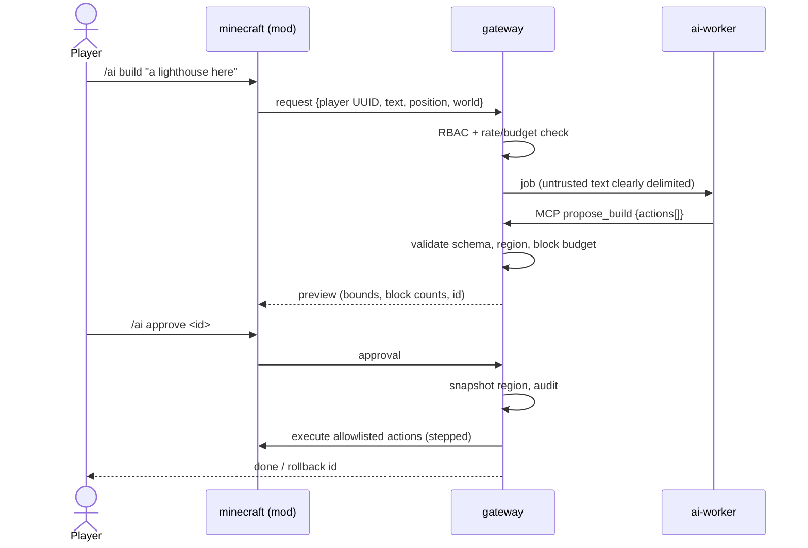

# Architecture overview

> Planned architecture as of Phase 0. Sections are marked **implemented** as each phase lands.

## Components

| Service | Responsibility | Trust level | Talks to |
| --- | --- | --- | --- |
| `minecraft` | itzg/minecraft-server (Fabric) + the `mcai` server mod. Game only. | Untrusted input (players) | gateway (mod → gateway API, token-authenticated) |
| `gateway` | Player/request routing, RBAC checks, action schema validation, allowlisted executor, previews, snapshots/rollback, rate and budget limits, audit. **The only component that changes the world.** | Trusted core | minecraft (RCON on the internal network only), ai-worker, automation, state |
| `ai-worker` | Runs Claude Code on demand with gateway MCP tools only. Holds the AI credential. | Semi-trusted (model output is untrusted) | gateway; egress to the AI provider only |
| `automation` | Event triggers + scheduler, persistence, dedup, loop/rate/token guards | Trusted core | gateway |
| `management` | Management API (RBAC enforced server-side) | Trusted core | gateway, state |
| `ssh-gateway` | OpenSSH, keys only, `ForceCommand` → `mcai` dispatcher; no shell, PTY-less, no forwarding | Edge | management |
| `state` | SQLite (WAL) on a volume: roles, identities, requests, automations, audit | Data | gateway, automation, management |

Combining gateway, automation and management into one process is allowed if it keeps the installation simpler. If
that happens, it will be recorded in an ADR. The trust boundaries above stay the same either way.

## High-level flow

## Networks and ports

- `internal` (Docker bridge, `internal: true`) connects minecraft ↔ gateway ↔ automation ↔ management ↔ state.
  RCON exists only here.
- `ai-egress` connects ai-worker ↔ internet (AI provider) and ai-worker ↔ gateway.
- Published to the host: the Minecraft game port and the SSH gateway port. Nothing else.

## Further reading

- [ADRs](adr/README.md)
- [Threat model](../security/threat-model.md)
- [Task board](../development/TASKS.md)
