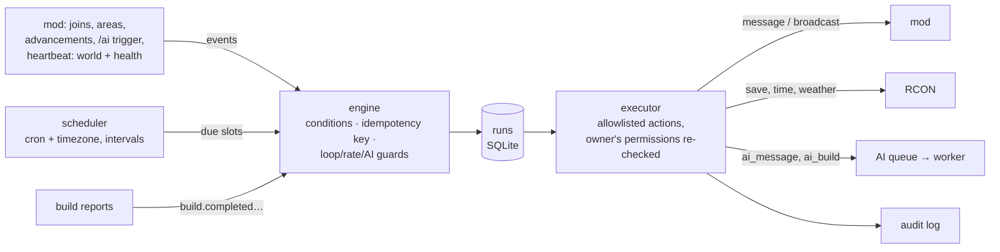
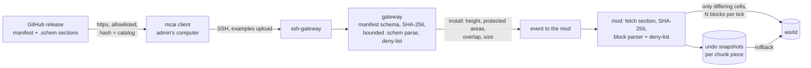
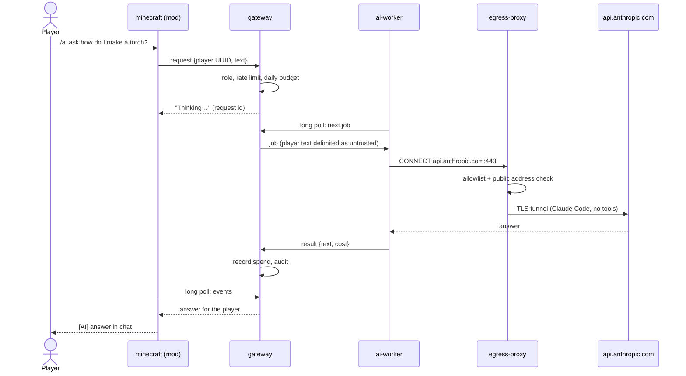
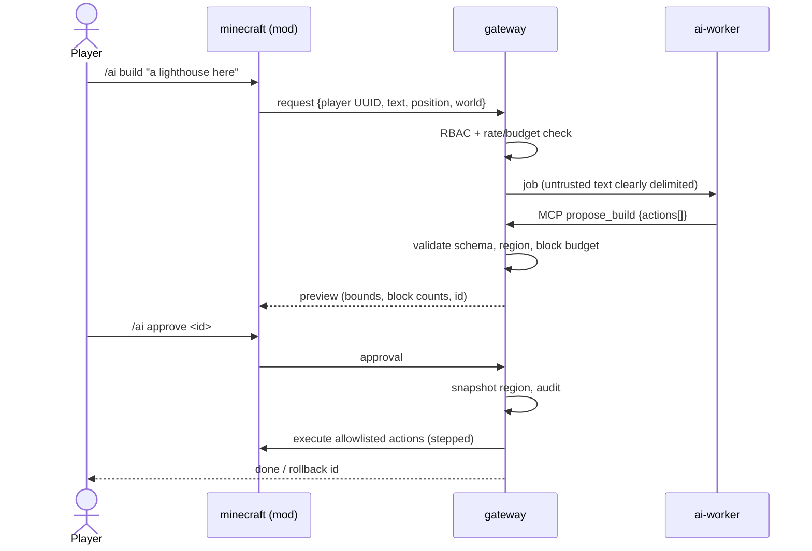

# Architecture overview

> Describes version 0.6.2. Every component below is implemented and tested; the
> [task board](../development/TASKS.md) tracks what is still open.

## Components

| Service | Responsibility | Trust level | Talks to |
| --- | --- | --- | --- |
| `minecraft` | itzg/minecraft-server (Fabric) + the `mcai` server mod: `/ai` commands, join/leave + health reports, previews, block placement, undo snapshots, example packs (verified `.schem` sections placed chunk by chunk), game events for automations (areas, advancements, `/ai trigger`, world time). **Implemented** | Untrusted input (players) | gateway (token-authenticated API) |
| `gateway` | Identities (player UUIDs, accounts), roles, request routing, plan validation, approvals, rate and budget limits, management API, automation engine, example pack store and installer, audit log, SQLite state. **The only component that decides.** **Implemented** | Trusted core | minecraft (mod API; RCON on the internal network for management commands), ai-worker, ssh-gateway |
| `ai-worker` | Runs Claude Code per job with no tools (questions) or two MCP proposal tools (builds). Holds the AI credential. **Implemented** | Semi-trusted (model output is untrusted) | gateway; the AI provider only, through `egress-proxy` |
| `egress-proxy` | HTTPS tunnels (CONNECT) to the host names in `EGRESS_ALLOW` only, never to IP addresses or private networks; logs each one. Standard-library Python (`src/mcai/egress.py`). **Implemented** | Edge | ai-worker; the internet |
| `ssh-gateway` | OpenSSH (unprivileged, keys only), `ForceCommand` → dispatcher; no shell, PTY, forwarding or files. **Implemented** | Edge | gateway management API |
| `backup` | itzg/mc-backup: scheduled world backups. **Implemented** | Data | minecraft (RCON, read-only data) |

The management API (ADR-0010) and the automation engine (ADR-0011) run inside the gateway, not as separate
services. The trust boundaries stay the same: the SSH gateway only authenticates and forwards, the gateway
authorizes every command, and automations can only use the allowlisted actions the gateway already has.

## Automations

## Example packs

The gateway has no internet access: the client downloads, and the gateway re-checks everything it receives
(ADR-0012).

## Asking a question

The mod and the worker both *pull* from the gateway (long polls), so the gateway never opens a connection to
anything. If the worker is down, questions wait in the queue; if the gateway restarts, the mod reconnects.

## Building

## Networks and ports

- `internal` (Docker bridge, `internal: true`) connects minecraft ↔ gateway ↔ ai-worker ↔ ssh-gateway ↔ backup.
  RCON exists only here.
- `ai-proxy` (`internal: true`) connects ai-worker ↔ egress-proxy only.
- `ai-egress` connects egress-proxy ↔ internet. No other service is on it.
- `edge` carries the published ports: the Minecraft game port and the SSH gateway port (127.0.0.1 unless the
  owner chooses otherwise). Nothing else is published.

## Further reading

- [ADRs](adr/README.md)
- [Threat model](../security/threat-model.md)
- [Task board](../development/TASKS.md)
