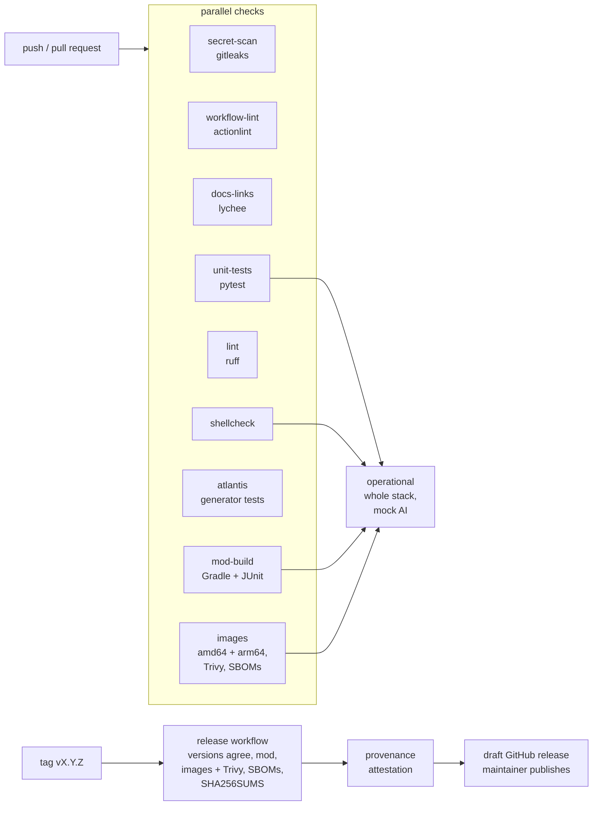

# Developer guide

How the code is organised, how to build and test it, and how changes get released. Read
[CONTRIBUTING.md](../../CONTRIBUTING.md) first for the ground rules, the
[architecture overview](../architecture/overview.md) for how the services fit together, and the
[threat model](../security/threat-model.md) before changing anything a player, an admin or the model can reach.

## Layout

| Path | What |
| --- | --- |
| `minecraft-mod/` | Fabric server mod (Java 21, Gradle + Fabric Loom, Yarn mappings): `/ai` commands, events, previews, block placement, undo snapshots, example placement |
| `src/mcai/` | Gateway, AI worker, egress proxy and SSH gateway dispatcher (Python 3.12, standard library only) |
| `management-cli/` | `mcai` command-line client and terminal UI (Python 3.9+, standard library only) |
| `containers/*/Dockerfile` | Service images. The build context is the repo root, and `.dockerignore` only lets `src/mcai` in |
| `examples/` | `catalog.json` (packs and pinned checksums) and `atlantis/generator`, which builds the Atlantis packs |
| `automation-examples/` | Example automations, also used as test fixtures |
| `scripts/` | Setup wizard, doctor, backup and restore, mod and example builds, the private deny-list check |
| `tests/unit`, `tests/integration` | pytest. No Docker, network or AI credentials needed (mock provider) |
| `tests/operational/` | Real containers: `first_start.sh` (the whole stack, ~6 min) and `clean_machine.sh` (the installation guide on a fresh Ubuntu host, ~15 min) |

### Where things live in `src/mcai`

| Module | Responsibility |
| --- | --- |
| `gateway.py` | HTTP API for the mod and the worker (token-authenticated, long polls), request routing, approvals, budgets |
| `store.py` | SQLite state, one connection under one lock; the hash-chained audit log |
| `rbac.py`, `management.py`, `sshgw.py`, `sshkeys.py` | Roles and permissions, the management commands, the SSH forced-command dispatcher, key handling |
| `worker.py`, `providers.py`, `prompt.py`, `mcp_build.py` | AI worker: polls jobs, runs Claude Code (no tools for questions, two MCP proposal tools for builds); the mock provider |
| `plan.py`, `sanitize.py` | Build plan schema and validation (region, budget, block allowlist); untrusted text handling |
| `automation.py`, `cron.py` | Automation engine: definitions, triggers, guards, the scheduler |
| `examples.py` | Example pack manifests, bounded `.schem` parsing, the installer |
| `egress.py` | The AI worker's only way out: a CONNECT-only HTTPS proxy with a host allowlist |
| `rcon.py`, `config.py`, `ratelimit.py`, `hostadmin.py` | RCON client, settings from the environment, rate limits, host-side admin helpers |

## Set up

You need Docker and Python 3.12 or newer (what CI uses). Java isn't needed: the mod builds in a pinned container.

```bash
python3 -m venv .venv && .venv/bin/pip install -r requirements-dev.txt
pipx install pre-commit && pre-commit install       # gitleaks before every commit
```

## Build and test

```bash
.venv/bin/pytest                          # unit + integration, about a minute
.venv/bin/ruff check .                    # lint (ruff.toml)
scripts/build-mod.sh                      # build + unit-test the mod in a container
tests/operational/first_start.sh          # the whole stack in a temp copy, mock AI
tests/operational/clean_machine.sh        # the installation guide on a fresh Ubuntu 24.04 host
```

After changing the code, on a running stack:

| Changed | Apply with |
| --- | --- |
| `src/mcai` | `docker compose up -d --build gateway ai-worker egress-proxy ssh-gateway` |
| `minecraft-mod/` | `scripts/build-mod.sh`, then `scripts/setup.sh --non-interactive` (records the jar's checksum) and `docker compose up -d minecraft` |
| `compose.yaml`, `.env` | `docker compose up -d` |
| `examples/atlantis/generator` | `scripts/build-examples.sh`, which rebuilds the packs and pins new checksums in `examples/catalog.json` |

To try the AI without a credential or cost, set `AI_PROVIDER=mock` in `.env`.

### What the tests cover

| Suite | Covers |
| --- | --- |
| `tests/unit` | Plan validation, sanitising, RBAC and keys, cron, automation definitions, example manifests and `.schem` parsing, the egress allowlist, the setup wizard, restore safety, the CLI and TUI, and the security properties of `compose.yaml` (no Docker socket, no published RCON, pinned images, internal networks) |
| `tests/integration` | The gateway over real HTTP with the mock provider: question and build flows, approvals and undo, management commands per role, automations with a fake clock, example uploads and installs, long-poll failure handling |
| mod (`scripts/build-mod.sh`) | JUnit tests of the chat text, area, plan and example placement logic |
| `first_start.sh` | Setup, health, `/ai ask` and `/ai build` from the server console, SSH administration per role, automations, Atlantis Lite install and rollback, backup and restore, crash recovery, gateway and worker outages, the egress proxy, a server crash during an example install |
| `clean_machine.sh` | The installation guide, followed literally, on a host with nothing pre-installed |

Anything a player or the model can reach needs a security test: an injection string, an out-of-region or
over-budget plan, an unauthorised role.

## Continuous integration



CI never calls a paid API: every AI path uses the mock provider. Trivy fails the build on fixable HIGH or
CRITICAL vulnerabilities in the images. Each run uploads the SBOMs as an artifact.

## Releasing

1. Bring the versions in line: `mod_version` in `minecraft-mod/gradle.properties`, and `__version__` in
   `src/mcai/__init__.py` and `management-cli/mcai_cli.py`. The release workflow refuses a tag that doesn't match
   all three.
2. Move the `[Unreleased]` section of `CHANGELOG.md` under the new version and date.
3. Optional dry run: **Actions → release → Run workflow** builds everything and keeps it as an artifact.
4. Tag and push: `git tag -a v0.7.0 -m v0.7.0 && git push origin v0.7.0`.
5. The workflow creates a **draft** release with the mod jar, SBOMs, `SHA256SUMS` and provenance attestations.
   Check it, then publish it.

Example packs are released separately, under `examples-X.Y.Z` tags, because they change rarely and are large.
`scripts/build-examples.sh` builds them, and their checksums are pinned in `examples/catalog.json`.

## Updating pinned versions

Dependabot covers GitHub Actions, the images in `compose.yaml` and the Dockerfiles, Gradle and pip. Update these by
hand:

- **Claude Code:** `ARG CLAUDE_CODE_VERSION` in `containers/claude/Dockerfile`. Pick a release that is at least two
  weeks old, rebuild, and run the tests.
- **Gradle build image:** the `IMAGE=` digest in `scripts/build-mod.sh`.
- **Fabric versions:** `minecraft-mod/gradle.properties` and `MC_*` in `.env.example`.
- **Scanner images** (Trivy, Syft) in the workflows, and the Ubuntu image in `tests/operational/clean_machine.sh`.

When you add or replace a dependency, update [THIRD_PARTY.md](THIRD_PARTY.md) (component, use, license).

## Rules

See [CONTRIBUTING.md](../../CONTRIBUTING.md), the [threat model](../security/threat-model.md) and
[ADR-0006](../architecture/adr/0006-ai-gets-actions-not-shells.md). New architecture decisions get an ADR in
[`docs/architecture/adr/`](../architecture/adr/README.md).
