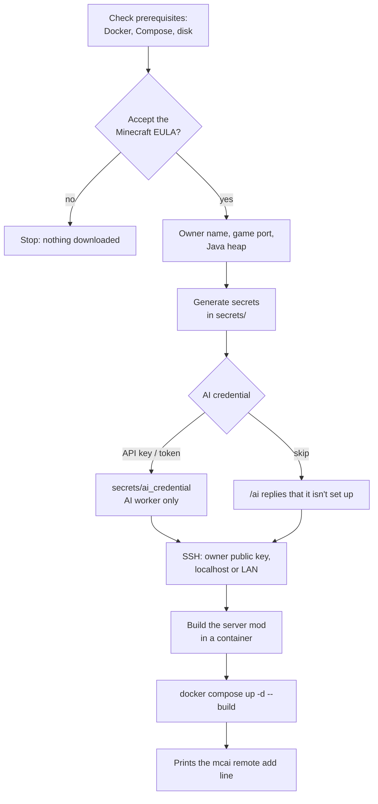

# Installation

This guide takes you from a computer with nothing installed to a running server you can join. It takes about
30 minutes, most of it downloads. Each step was run, exactly as written, on a fresh Ubuntu 24.04 host
(`tests/operational/clean_machine.sh`); the table below says which other systems were tried.

## Supported hosts

| Host | Architecture | Status |
| --- | --- | --- |
| Pop!_OS 26.04 (Ubuntu base), Docker Engine 29.1, Compose 2.40 | x86_64 | **Verified** (manual + `tests/operational/first_start.sh`) |
| Ubuntu 24.04, fresh host, Docker CE 29.10 from Docker's apt repository, Compose 5.8 | x86_64 | **Verified** (clean-machine install, `tests/operational/clean_machine.sh`) |
| GitHub Actions `ubuntu-24.04` runner | x86_64 | **Verified in CI** (operational job) |
| Other Linux with Docker Engine ≥ 24 and Compose ≥ 2.24 (Debian, Ubuntu, Fedora…) | x86_64 / arm64 | Expected to work, **unverified** |
| macOS with Docker Desktop | Apple silicon / Intel | Expected to work, **unverified** |
| Windows 11 with Docker Desktop (WSL 2 backend). Run the scripts inside a WSL 2 distribution | x86_64 / arm64 | Expected to work, **unverified** |

Both images used (`itzg/minecraft-server`, `itzg/mc-backup`) are published for amd64 and arm64.

**Resources:** 2 CPU cores, 5 GB of free disk space plus space for backups, and enough RAM for the Java heap you
choose plus about 2 GB. **Use a heap of at least 4 GB** (the default, `--memory 4G`). 2 GB starts and is fine for
one or two players exploring, but it is too small for the example builds: installing Atlantis Full on a 2 GB heap
ran out of memory in testing.

| Java heap (`MC_MEMORY`) | Good for | Container limit (`MC_MEM_LIMIT`) | Free RAM on the host |
| --- | --- | --- | --- |
| 2G | testing only: 1-2 players, no example builds | 4g | 4 GB |
| **4G (default, recommended)** | up to about 5 players, AI builds, Atlantis Lite | 7g | 6-8 GB |
| 6G | Atlantis Full, 5-10 players, a larger view distance | 10g | 8-12 GB |
| 8G | 10+ players or many extra mods | 13g | 12-16 GB |

A bigger heap than you need doesn't make the server faster: the garbage collector just has more to scan. To change
it later, see [Memory](../administration/README.md#memory) in the admin guide.

## 1. Install Docker

- **Linux:** follow <https://docs.docker.com/engine/install/> for your distribution, including the *Compose plugin*.
  Then let your user run Docker: `sudo usermod -aG docker $USER`, and log out and back in.
- **macOS / Windows:** install Docker Desktop: <https://docs.docker.com/desktop/>. On Windows, enable the WSL 2
  backend and use a WSL terminal for the commands below.

Check that it works: `docker run --rm hello-world` and `docker compose version` (2.24 or newer).

## 2. Get the platform

```bash
git clone https://github.com/JasonEamesLamarca/minecraft-claude-platform.git
cd minecraft-claude-platform
```

## 3. Run the setup wizard

```bash
scripts/setup.sh
```



It will:

1. Check prerequisites: Docker, Compose version, architecture, disk space.
2. Ask you to read and accept the [Minecraft EULA](https://www.minecraft.net/eula). Nothing is downloaded or
   started unless you type `yes`.
3. Ask for **your Minecraft Java username**, the name your launcher shows, and check that the account
   exists. You become the only operator and the first whitelisted player.
4. Ask for the game port (default 25565) and the Java heap size (e.g. `4G`). The container memory limit is set to
   about 1.5× the heap.
5. Generate random internal secrets in `secrets/` (mode 600), such as the RCON password.
6. Ask how Claude should authenticate:
   - an **Anthropic API key** from <https://console.anthropic.com> (pay per use; recommended),
   - a **subscription token** from `claude setup-token`. Read the terms notice the wizard shows, and
     [ADR-0003](../architecture/adr/0003-ai-authentication.md),
   - or **skip**: `/ai` then replies that the AI isn't set up.

   The credential goes to `secrets/ai_credential`, never `.env`, and only the AI worker container can read it.
7. Set up **SSH administration**:
   - Ask whether other computers on your network may connect. The default is no: only this computer.
   - Ask for your SSH **public** key file (default `~/.ssh/id_ed25519.pub`; create one with
     `ssh-keygen -t ed25519`). It becomes the `owner` account's key.
8. Build the server mod in a container on first run (no Java needed; a few minutes). Then validate
   `compose.yaml` and offer to start everything. After starting, it prints the `mcai remote add ...` line that
   connects your computer, including the server's host key.

`.env` and `secrets/` are git-ignored. Re-running the wizard keeps your existing secrets and settings.

Non-interactive use (scripts, CI):

```bash
scripts/setup.sh --non-interactive --accept-eula --owner YourName --port 25565 --memory 4G --ai-auth none \
  --ssh-key ~/.ssh/id_ed25519.pub --ssh-bind 127.0.0.1 --start
```

## 4. Start and check

```bash
docker compose up -d          # if you didn't start from the wizard
scripts/wait-healthy.sh minecraft 900
scripts/doctor.sh             # prerequisites, config, health, resource use, recent errors
```

The first start downloads Minecraft, the Fabric loader and Fabric API, and builds the gateway and AI worker
images. This takes a few minutes. Six services run: `minecraft`, `backup`, `gateway`, `ai-worker`,
`egress-proxy` and `ssh-gateway`.

**Test administration:** `management-cli/mcai status` (after the `mcai remote add` line from the wizard). See
[Remote administration and roles](../administration/README.md#remote-administration-and-roles).

**Test the AI:** in game, type `/ai ask how do I make a torch?`. Without a credential, set `AI_PROVIDER=mock` in
`.env` and run `docker compose up -d` to get canned answers.

## 5. Connect

In Minecraft Java Edition (same version as `MC_VERSION`, default 1.21.1), choose **Multiplayer → Add Server** and
enter:

- `localhost:PORT` from the same computer,
- `<LAN IP of the host>:PORT` from your home network.

Only whitelisted players can join. To add a friend, see [administration](../administration/README.md).

### Firewall and internet access

- Docker publishes the game port on all interfaces by default (`MC_BIND_ADDRESS=0.0.0.0`). On Linux, **Docker's
  port publishing bypasses `ufw`/`firewalld` rules**. To keep the server LAN-only, rely on your router (don't
  forward the port), or set `MC_BIND_ADDRESS` to a specific LAN IP.
- To let friends join from the internet, forward the TCP game port on your router. Keep the whitelist on.
- RCON (25575) is **never** published. It exists only on the internal Docker network.
- The SSH administration port (`MCAI_SSH_PORT`, default 2222) listens on 127.0.0.1 unless you allowed your
  network in the wizard. Don't forward it on your router: use a VPN to administer from outside.

## Updating

Back up, check out the new release, re-run the wizard and rebuild:

```bash
scripts/backup.sh
git fetch --tags && git checkout vX.Y.Z
scripts/setup.sh              # keeps your answers, rebuilds the mod, offers to restart
```

The [upgrade guide](../upgrade/README.md) has the details, including backing up the gateway's state and rolling
back.

## Removing the platform

```bash
docker compose down           # stops and removes containers and networks; your data stays
```

Your world is in `data/minecraft/` and your backups are in `backups/`. Delete those folders yourself only once you
are sure you no longer need them.
