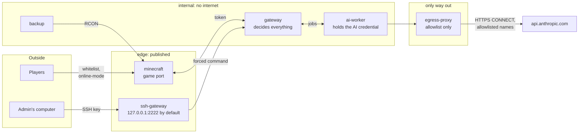

# Security guide

This guide is for the person running the server: what the platform protects by default, what you decide, and
what to check before letting people in. The [threat model](threat-model.md) covers the reasoning and every
mitigation in detail; [SECURITY.md](../../SECURITY.md) explains how to report a vulnerability.

## What protects you by default

**The AI can't do anything you haven't allowed.** Claude never gets a shell, files, RCON or operator rights.
For a question it gets no tools at all. For a build it gets two tools that *propose* a plan. The gateway then
checks the plan against the player's role, the allowed region, the block budget and the protected areas, shows a
preview, and only builds after a human approves. Every build can be undone. Text players write (chat, signs,
books) is treated as untrusted data. That limits what prompt injection can do: it can change what the AI
proposes, but not what the platform allows ([ADR-0006](../architecture/adr/0006-ai-gets-actions-not-shells.md)).

**Each service only reaches what it needs:**



- Only two ports are published: the game port, and the SSH administration port on 127.0.0.1 unless you
  allow your network. RCON is never published.
- The gateway, AI worker and backup service have no route to the internet. The AI worker reaches the AI
  provider only through `egress-proxy`, which allows HTTPS to the host names in `EGRESS_ALLOW` and nothing else:
  no IP addresses, no private networks. It logs every connection.
- No container gets the Docker socket. Every container runs as an unprivileged user, drops all Linux
  capabilities, can't gain privileges, and has memory and process limits. The platform's own containers also have
  read-only file systems.

**Players are who they say they are.** `online-mode` checks every player with Mojang, the whitelist is on, and
roles are tied to player UUIDs, never to names. Only the owner is an operator, and the operator list is reset to
the owner at every start: an `/op` given in game lasts until the next restart. Give people
[roles](../administration/README.md#roles) instead.

**Administration is key-only and limited.** The SSH gateway accepts keys only, runs one fixed command (no shell,
terminal, port forwarding or file transfer), and the gateway checks the account's role for every command. Every
change goes to a hash-chained audit log, which `mcai audit verify` checks.

**Downloads are pinned.** Example packs come only from allowlisted release URLs. They must match checksums pinned
in the catalog, and the gateway and the mod check them again before placing anything. Images are pinned by
digest, and GitHub Actions are pinned by commit.

## What you decide

| Decision | Safer choice | Where |
| --- | --- | --- |
| Who can join | Keep the whitelist on (`MC_WHITELIST=true`) and `MC_ONLINE_MODE=true` | `.env` |
| Exposing the game to the internet | Only if friends outside need it. Forward only the game port | your router |
| Remote administration | Keep `MCAI_SSH_BIND=127.0.0.1`; use a VPN from outside. Never forward the SSH port | setup wizard |
| AI credential | An API key with a [spend limit](https://console.anthropic.com/settings/limits) set at Anthropic | setup wizard |
| AI spending | `AI_DAILY_BUDGET_USD` and `AI_MAX_REQUEST_USD` as low as works for you | `.env` |
| Who may use the AI and build | Give `builder` only to people you trust with the world | `mcai players role` |
| Extra hosts for the AI | Leave `EGRESS_ALLOW` at `api.anthropic.com` | `.env` |

**About the AI credential:** an API key bills per use and can carry a spend limit at Anthropic. A subscription
token uses your Claude plan; read the notice in the wizard and
[ADR-0003](../architecture/adr/0003-ai-authentication.md) first. Either way it's stored in `secrets/ai_credential`
(mode 600), mounted only into the AI worker, never put in `.env` and never logged. Anyone with access to your
host's files can read it, so revoke it at Anthropic if the host is ever compromised.

## Before you open the server to others

1. `scripts/doctor.sh` is all green.
2. `.env` and everything in `secrets/` are mode 600 and owned by you: `ls -l .env secrets/`.
3. The whitelist holds only people you know: `mcai whitelist list`.
4. Roles are what you meant: `mcai players list`. `builder` and above can change the world through the AI.
5. Only the ports you intended are open from outside. From another network (a phone off Wi-Fi), the game port
   answers if you forwarded it, and the SSH port doesn't.
6. A spend limit is set on the Anthropic side, and `AI_DAILY_BUDGET_USD` is set.
7. Backups run, and a copy goes off the machine (another disk, NAS or cloud).

## Keeping it safe

- **Update.** Security fixes come as platform releases: see [upgrading](../upgrade/README.md). Watch the
  repository's releases, or its security advisories.
- **Check the audit log now and then:** `mcai audit history` shows who did what, and `mcai audit verify` checks
  nothing was edited.
- **Revoke what you no longer use:** `mcai accounts key-revoke` for SSH keys of people who leave,
  `mcai accounts disable` for whole accounts, and remove ex-players from the whitelist.
- **Treat backups as sensitive.** They contain `server.properties` (with the RCON password) and player UUIDs.
  `backups/` is mode 700. Keep off-machine copies somewhere private.
- **Logs contain player names and IP addresses.** Container logs rotate (5 × 10 MB per service); the audit log
  keeps `AUDIT_RETENTION_DAYS` (default 365). Remove personal data before sharing logs.

## Verifying a release

Every release lists `SHA256SUMS` and a GitHub build provenance attestation for its files (the server mod jar and
the SBOMs). With the [GitHub CLI](https://cli.github.com/):

```bash
sha256sum -c SHA256SUMS --ignore-missing
gh attestation verify mcai-fabric-0.7.0+mc1.21.1.jar --repo JasonEamesLamarca/minecraft-claude-platform
```

The SBOMs (`*.spdx.json`) list every package in the mod and in each image. Scanners such as Trivy or Grype read
them directly.

## Known limits

- A public game port is exposed to any vulnerability in the Minecraft server itself. Keep the platform updated,
  and keep the whitelist on.
- Within a player's role and budget, the AI can still propose builds that are odd or unwanted. That's why builds
  need approval and can be undone.
- Someone with access to your host's account or files has everything: secrets, world, backups.
- RCON listens on the minecraft container's internal addresses. It isn't published, but processes on the Docker
  host itself could reach it (the password still applies).

Full list and reasoning: [threat model](threat-model.md#residual-risks-accepted-documented-to-users).
