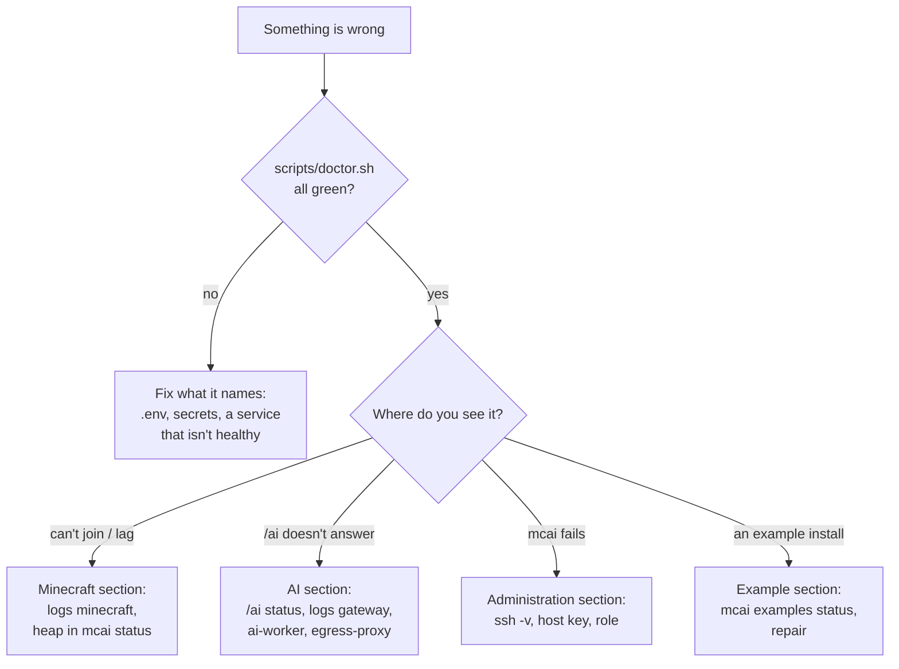

# Troubleshooting

Start with the doctor. It checks prerequisites, settings (never printing secrets), the health of every service,
CPU and memory use, and recent warnings in the logs:

```bash
scripts/doctor.sh
```

Then find your symptom below. Most answers end in a log, so the first table shows where each one lives.

| What | Command |
| --- | --- |
| One service's recent log | `docker compose logs --tail 100 minecraft` (or `gateway`, `ai-worker`, `egress-proxy`, `ssh-gateway`, `backup`) |
| Follow it live | `docker compose logs -f gateway` |
| Which services run, and their health | `docker compose ps` |
| Memory and CPU per container | `docker stats --no-stream` |
| Server, AI and backups at a glance | `management-cli/mcai status` |
| What happened, and who did it | `management-cli/mcai audit history` |



## Setup and start

**`Cannot talk to the Docker daemon`** (from `setup.sh`): Docker isn't running, or your user isn't in the
`docker` group. On Linux: `sudo usermod -aG docker $USER`, then log out and back in (a new terminal isn't
enough). `docker run --rm hello-world` must work without `sudo`.

**`Docker Compose v2 plugin missing`:** install the `docker-compose-plugin` package (Linux) or update Docker
Desktop. The platform needs `docker compose` (with a space) version 2.24 or newer, not the old `docker-compose`.

**`Mod build failed` with HTTP 429 or a timeout:** a download server rate-limited the build. Wait a few minutes and
re-run `scripts/setup.sh`; it resumes where it stopped.

**`Bind for 0.0.0.0:25565 failed: port is already allocated`:** another server (or another copy of this one) uses
the port. Pick another one: re-run `scripts/setup.sh` and change the game port, or set `MC_PORT` in `.env`, then
`docker compose up -d`. The same goes for the SSH port (`MCAI_SSH_PORT`, default 2222).

**`minecraft` keeps restarting:** `docker compose logs --tail 100 minecraft` names the cause. The usual ones:

| Log says | Cause and fix |
| --- | --- |
| `You need to agree to the EULA` | The EULA wasn't accepted. Re-run `scripts/setup.sh` |
| `Incompatible mods found` / `requires minecraft …` | `MC_VERSION` was changed by hand. Put back the value from `.env.example` (see [upgrading Minecraft](../upgrade/README.md#upgrading-minecraft-itself)) |
| `java.lang.OutOfMemoryError` or the container shows `OOMKilled` (`docker inspect mcai-minecraft-1 --format '{{.State.OOMKilled}}'`) | The heap or the container limit is too small. See [Memory](../administration/README.md#memory) |
| `Could not resolve user from Playerdb: <name>` | The owner name (`MC_OWNER`) isn't a Minecraft Java account, usually a typo. Re-run `scripts/setup.sh` and enter the name shown in your launcher |
| `Failed to download` | No internet on the first start, or a mod host is down. Try again later |

**The first start takes ages:** it downloads Minecraft, Fabric and the mods, builds four images and generates the
world. 5 to 15 minutes is normal; `scripts/wait-healthy.sh minecraft 900` waits up to 15 minutes.

## Joining the server

**The Minecraft launcher shows a page of HTML or CSS instead of the game**, or login fails before the server list:
that's the launcher's sign-in with Microsoft, not this server. Sign out and back in to your Microsoft account in
the launcher. If your launcher joins a server automatically at start, turn that off until you're signed in again.

**`Can't connect to server` / `Connection refused`:** check that `minecraft` is healthy (`docker compose ps`), that you
used the right port (`localhost:PORT` on the same computer, `<LAN IP>:PORT` from another one), and that a firewall
between you allows it. For friends on the internet the port must be forwarded on your router.

**`You are not white-listed on this server!`:** add the player:
`docker compose exec minecraft rcon-cli "whitelist add Name"`, or `mcai whitelist add Name`.

**`Failed to verify username!`:** the server checks every player with Mojang (`online-mode`). The player's launcher
must be signed in to a Microsoft account that owns Minecraft Java Edition.

**`Outdated client!` / `Outdated server!`:** the client's version must match `MC_VERSION` (default 1.21.1). In the
launcher, create an installation for that version.

## Lag and memory

**`Can't keep up! Is the server overloaded?` in the log, rubber-banding in game:** look at the heap in
`mcai status`. Above 90% most of the time means it's too small: see [Memory](../administration/README.md#memory).
A heap of 4 GB is the default; use 6 GB for Atlantis Full or 5-10 players.

**Lag right after installing a big example:** water, sand and gravel in newly placed builds can keep the server
busy. The example installer clears those pending updates for what it places. If a player was standing next to the
build while it was placed, run `mcai examples repair <install>`. It puts every block back as designed.

**Short lag once a day:** that's the backup (`save-all flush`). Move it with `BACKUP_INTERVAL` and
`BACKUP_INITIAL_DELAY` in `.env`.

## The AI (`/ai`)

Start with `/ai status` in game or `mcai status`. They show whether the AI is on, the worker online, and today's
spend.

| Message | Cause and fix |
| --- | --- |
| `The AI is not set up on this server yet` | No credential. Re-run `scripts/setup.sh` and choose an API key or a subscription token. For testing without one, set `AI_PROVIDER=mock` in `.env` and run `docker compose up -d` |
| `The AI is switched off on this server right now` | An admin ran `mcai ai disable`. `mcai ai enable` switches it back on |
| `You are not allowed to use the AI.` / `Building with the AI needs the builder role` | The player's role. `mcai players role <name> builder` (see [roles](../administration/README.md#roles)) |
| `The AI has reached today's budget` | `AI_DAILY_BUDGET_USD` was reached; it resets at 00:00 UTC. Raise it in `.env` if you mean to |
| `Too many requests. Try again in N s.` | The per-player limit, `AI_PLAYER_REQUESTS_PER_MINUTE` |
| `The AI service is not reachable right now` | The gateway is down or restarting. `docker compose ps gateway`, `docker compose logs gateway` |
| `AI worker: offline` | `docker compose ps ai-worker`; `docker compose up -d ai-worker`. Questions wait in the queue meanwhile |
| `AI request … failed: …` | Read the reason, and `docker compose logs ai-worker` for Claude Code's own message. An authentication error means the credential was revoked or mistyped: re-run `scripts/setup.sh`. `claude timed out` or an overloaded provider: try again later |

**The AI never answers, and the worker log shows connection errors:** the AI worker reaches the internet only
through `egress-proxy`, and only for the hosts in `EGRESS_ALLOW` (default `api.anthropic.com`). Every refused
connection is a `"event":"denied"` line in `docker compose logs egress-proxy`, with the host and the reason. If
your provider needs another host, add it to `EGRESS_ALLOW` (comma-separated host names) and run
`docker compose up -d`. If the proxy itself can't connect (`"event":"failed"`), check the host's internet access
and DNS.

**A build preview never arrives:** builds take longer than questions (up to a few minutes). `/ai status` shows the
request; `/ai cancel` drops it. `The AI didn't come up with a plan for that` means the model gave up: describe the
build differently, or smaller.

## Administration (`mcai`)

**`Connection refused`:** the SSH gateway listens on 127.0.0.1 unless you allowed your network in the wizard.
From another computer, re-run `scripts/setup.sh` and answer yes to "Allow administration from other computers",
or use a VPN to the host.

**`Permission denied (publickey)`:** your key isn't on an account. `mcai` uses the key from
`mcai remote add … --identity`, or your SSH agent. On the server, the owner can list keys with
`mcai accounts keys <account>`. If the owner key itself is lost, see
[Recovery: lost owner key](../administration/README.md#recovery-lost-owner-key).

**`Host key verification failed` or a host key warning:** the SSH gateway's host key changed, which happens only
if `data/ssh-gateway/` was deleted, or if something else answers on that address. If you know why it changed,
run `mcai remote add` again with the `--host-key` line that `scripts/setup.sh` prints. If you don't, stop and find
out first.

**`not permitted` / `You can't …`:** the account's role doesn't allow it. `mcai whoami` shows your account and role.

**`mcai audit verify` reports a break:** a record of the audit log was edited or deleted. Compare with your backups
of `data/gateway/audit/` and treat it as a security incident if you can't explain it.

## Example builds (Atlantis)

**`mcai examples download` fails with HTTP 404:** the catalog points at a release that isn't public, or you're
offline. `mcai examples download <pack> --from <folder>` installs a pack you built with
`scripts/build-examples.sh`.

**`checksum … doesn't match`:** the downloaded file isn't the one the catalog pins. Nothing of it was kept or sent to
the server. Try again later; if it keeps failing, report it.

**An install stopped part way (`interrupted`):** the server restarted during the install. `mcai examples status`
shows it, and `mcai examples repair <install>` finishes it. `mcai examples rollback <install> --yes` undoes it instead.

**Water falling through a hole, or a broken wall, after an install:** a player was in the area while it was being
placed. Run `mcai examples repair <install>`.

## Backups and restore

**No backups appear:** backups are skipped while nobody is online (`BACKUP_PAUSE_IF_NO_PLAYERS=true`). Take one by
hand with `scripts/backup.sh`. `docker compose logs backup` shows the schedule.

**`restore.sh` refuses an archive:** the archive contains absolute paths or `..`, so it didn't come from this
platform. Use a backup from `backups/`.

## Still stuck?

Open an issue with the output of `scripts/doctor.sh` and the relevant log lines. **Remove** player names, IP
addresses and anything from `secrets/` first. The doctor never prints secrets, but logs may contain player names.
Report security problems privately, as [SECURITY.md](../../SECURITY.md) describes.
