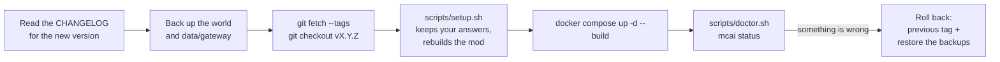

# Upgrading

An upgrade replaces the platform's code: the server mod, the gateway, AI worker, egress proxy and SSH gateway
images, and the pinned versions of the Minecraft and backup images. It doesn't touch your data: the world
(`data/minecraft/`), the gateway's state and audit log (`data/gateway/`), your settings (`.env`), your secrets
(`secrets/`) and your backups (`backups/`) all stay where they are.



## Before you start

- **Read [CHANGELOG.md](../../CHANGELOG.md)** for every version between yours and the new one. Before 1.0, a minor
  version (0.6 → 0.7) may change settings or behaviour; the changelog says what to do.
- **Check your version:** `git describe --tags` in the platform folder. `ls dist/mod` shows the server mod's
  version; `mcai status` starts with the command-line client's version.
- **Tell your players.** The Minecraft server restarts during the upgrade (usually under two minutes).
- **Disk space:** the new images need about 2 GB while the old ones are still there.

## Upgrade, step by step

1. **Back up the world** (pauses saving and flushes it, so the copy is consistent):

   ```bash
   scripts/backup.sh
   ```

2. **Back up the gateway's state** (accounts, roles, automations, installed examples, the audit log). The world
   backup doesn't include it:

   ```bash
   docker compose stop gateway
   tar czf "backups/gateway-$(date -u +%Y%m%dT%H%M%SZ).tar.gz" data/gateway
   docker compose start gateway
   ```

3. **Get the new version.** Releases are git tags; prefer a tag to the tip of `main`:

   ```bash
   git fetch --tags
   git checkout v0.7.0            # the version you want; `git tag --sort=-v:refname | head` lists them
   ```

   If `git checkout` refuses because of local changes, you edited a tracked file. `git stash` keeps your edit
   aside; settings belong in `.env`, which git ignores.

4. **Re-run the setup wizard.** It keeps every answer you gave before (press Enter to accept each one), adds any
   new settings with their defaults, and rebuilds the server mod when its version has changed:

   ```bash
   scripts/setup.sh
   ```

   Answer **yes** to "Start the server now?". That runs `docker compose up -d --build`, which rebuilds the
   platform images and recreates only the containers that changed.

   Without questions (scripts): `--non-interactive` keeps every saved answer, builds the new mod and records
   its checksum; then start the stack yourself:

   ```bash
   scripts/setup.sh --non-interactive
   docker compose up -d --build
   ```

   `docker compose pull` alone is **not** an upgrade: the platform's own images are built locally, so pulling
   doesn't change them. Always use `up -d --build`.

5. **Check it:**

   ```bash
   scripts/wait-healthy.sh minecraft 900
   scripts/doctor.sh
   management-cli/mcai status         # server, AI worker and backups at a glance
   ls dist/mod                        # the new mod version
   ```

   In game, `/ai status` should report the AI worker as online.

6. **Clean up old images** once you're happy: `docker image prune` removes the replaced, untagged images.

## Rolling back

If the new version misbehaves, go back to the previous tag and, if the new version already changed your data,
restore the backups you took in steps 1 and 2:

```bash
git checkout v0.6.2                       # the version you had
scripts/setup.sh                          # rebuilds the old mod and images
docker compose stop gateway
mv data/gateway "data/gateway.after-upgrade-$(date -u +%Y%m%dT%H%M%SZ)"
tar xzf backups/gateway-<time>.tar.gz     # restores data/gateway
scripts/restore.sh backups/<world>-<time>.tar.gz   # only if the world needs it; restarts the server
docker compose up -d --build
```

The gateway upgrades its database in place when it starts (it only adds tables and columns). An older gateway
usually runs on a newer database, but that isn't tested, so restore `data/gateway` when rolling back across a
version whose changelog mentions the database.

## Upgrading Minecraft itself

The Minecraft version (`MC_VERSION`), the Fabric loader and Fabric API are pinned together with the server mod,
because the mod is compiled against one Minecraft version. Change them only through a platform release that
supports the new version. Changing `MC_VERSION` in `.env` by hand stops the mod from loading, and `/ai` disappears.
Minecraft converts the world to the new version on the first start and can't convert it back, so a world backup
before a Minecraft upgrade is essential.

## Example packs

Installed examples (Atlantis) stay installed across upgrades, and their undo snapshots stay valid. A new platform
version may ship a new `examples/catalog.json` with new pack versions. `mcai examples list` shows them. Installing a
new pack version over an installed one needs a rollback of the old one first.
