# Atlantis

An underwater city under a 1,200-block glass dome: a central tower, ten districts on rings and six piers, landing
pads, gardens, a fountain plaza and the sea floor around it. It is an original design, made by this project's own
generator. The legend of Atlantis is public domain; no element of any film, series or game is used. The fountain
plaza borrows Plato's description instead: an island ringed by bands of water and land.

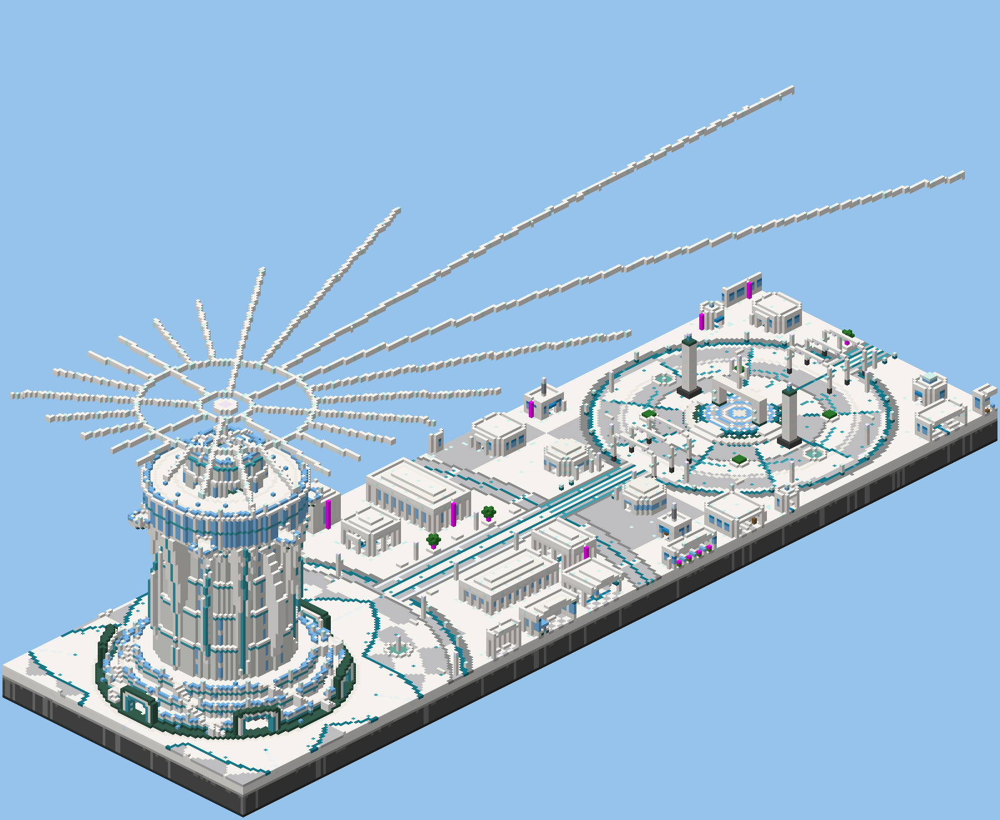

*Render made by the generator (`atlantis.orchestrate render`), not an in-game screenshot.*

## In game

Genuine screenshots of Atlantis Lite, installed with `mcai examples install` on the project's test server
(Fabric 1.21.1, vanilla client, default settings, no shaders), 19 Nov 2026. Not edited, only converted to JPEG.

| | |
| --- | --- |
| 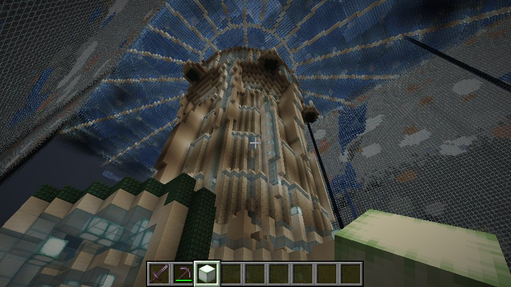 | 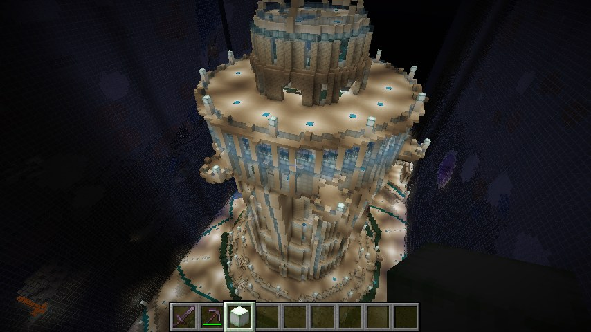 |
| *The central tower from its plaza* | *The top of the tower* |
| 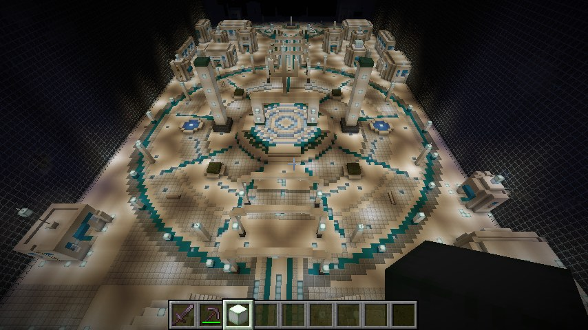 | 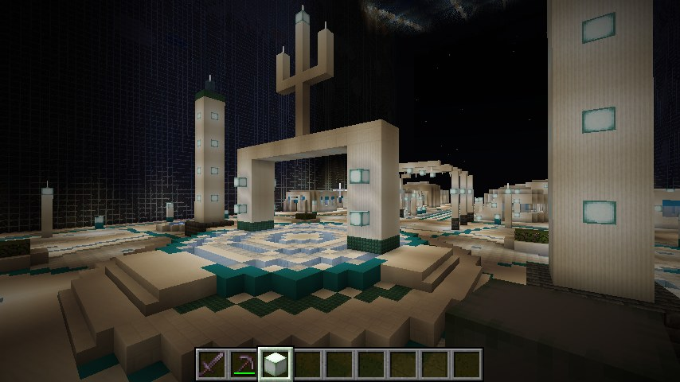 |
| *The Fountain Plaza and its rings* | *The Trident Arch* |
| 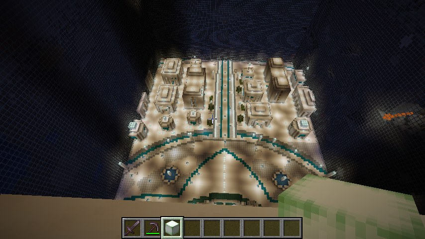 | 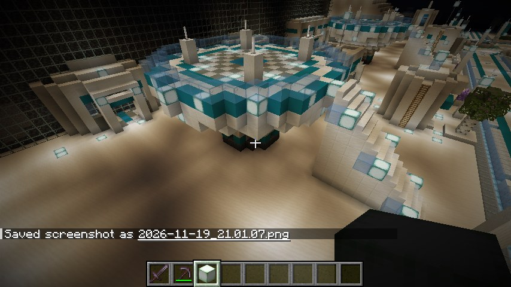 |
| *The district, seen from the tower* | *The grand avenue* |
| 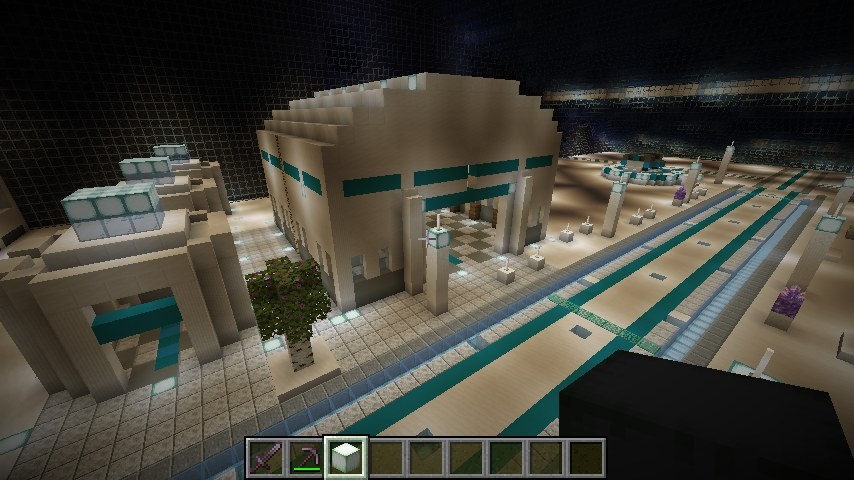 | 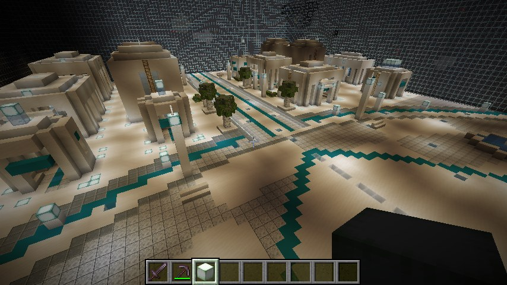 |
| *A hall beside the avenue* | *A library in the tower* |
| 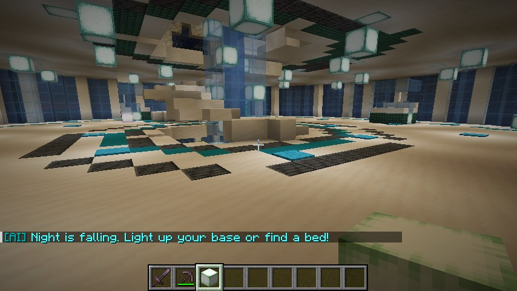 | 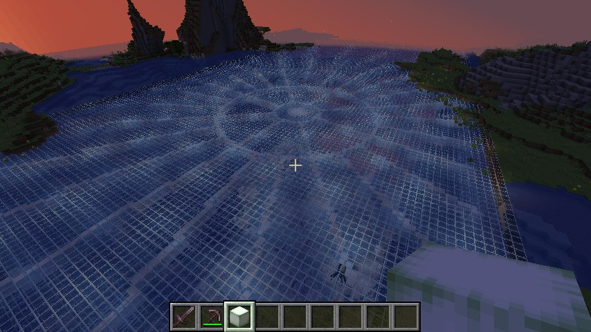 |
| *Inside the tower, with the `night-reminder` automation's chat message* | *The glass roof at sea level, from outside* |

## Two sizes

| Pack | Contents | Size | Blocks | Download |
| --- | --- | --- | --- | --- |
| **atlantis-lite** | a 96-block-wide cutaway from the tower along the north pier to the sea outside the dome | 96 x 127 x 768 | 9.4 million | 6 sections, 0.2 MB |
| **atlantis-full** | the whole city and its sea floor | 1,600 x 127 x 1,600 | 255 million | 90 sections, 4.7 MB |

Lite is sealed with glass on its cut sides and top, so you can place it on land or under water. Full needs a deep
ocean about 1,600 x 1,600 blocks wide: make a backup first.

## Install

On a running platform (admin or owner):

```bash
mcai examples download atlantis-lite
mcai examples install atlantis-lite --at 2000 -56 2000          # shows the area and asks for --yes
mcai examples install atlantis-lite --at 2000 -56 2000 --yes
mcai examples status <install>                                  # progress, then places to visit with coordinates
mcai automations install atlantis-tour && mcai automations enable atlantis-tour   # /ai trigger atlantis
```

`--at X Y Z` is where the city centre goes, at floor level. You walk at Y + 5. With Y = -56 the glass roof is at sea
level. `mcai examples rollback <install> --yes` restores the area. The
[admin guide](../../docs/administration/README.md#example-builds-atlantis) has the details, and
[ADR-0012](../../docs/architecture/adr/0012-example-packs.md) the design and the security checks.

## What's where (Lite)

| Place | From the anchor (x, y, z) |
| --- | --- |
| Central tower plaza | 0, 5, -40 |
| Fountain Plaza and the Trident Arch | 0, 5, -205 |
| North pier root | 0, 5, -300 |
| Landing pads and skiff hangar | 0, 5, -420 |
| Pier tip | 0, 5, -531 |
| Dome wall and the sea | 0, 5, -585 |

The tower has 15 floors: the Grand Atrium, labs, an archive, quarters, an observation deck and the navigation room
with its orrery near the top.

## Automations

`automations/` holds three automations made for this pack. `mcai automations examples` lists them next to the
general examples.

- **atlantis-arrival** greets players who walk into the installed city. Its area follows the install.
- **atlantis-tour** answers `/ai trigger atlantis` with the sights and their coordinates.
- **atlantis-restore** repairs the city every Monday at 05:00. It is privileged, so the owner approves it.

## Build it yourself

The packs are built from source and are reproducible. The content is identical everywhere; the compressed files
are byte-identical only with the same zlib version, so a home build may show as *unofficial*:

```bash
scripts/build-examples.sh lite                 # or full, or both (no argument); output in dist/examples/
mcai examples download atlantis-lite --from dist/examples
```

The generator (`generator/`, Python 3 standard library only) and its rules are described in
[generator/ARCHITECTURE.md](generator/ARCHITECTURE.md). Run its tests with `python3 generator/tests/run_all.py`.
Change `generator/config/atlantis.json` (seed, density, dome) to make your own variant. Builds that don't match the
catalog are installed as *unofficial* and go through the same checks.

## Licence

Code and generated packs: Apache-2.0, like the rest of the project.
